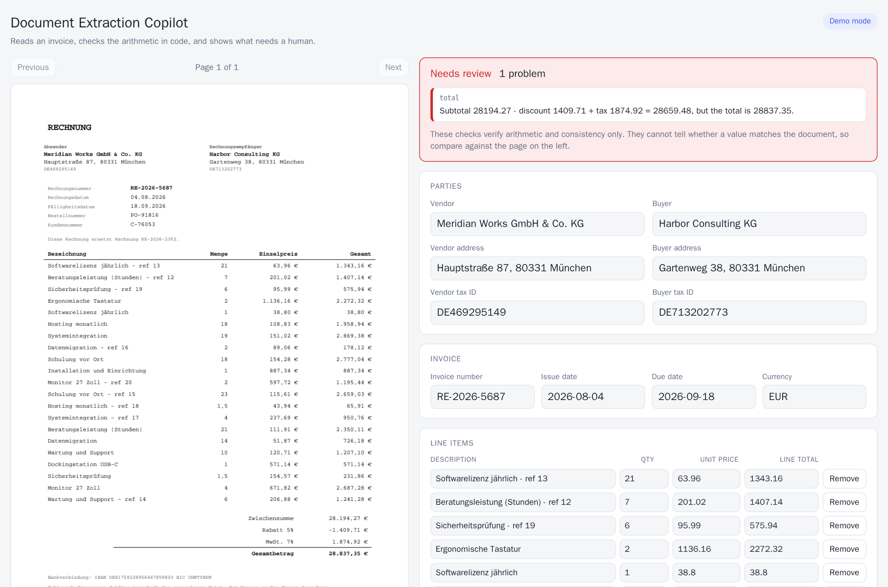
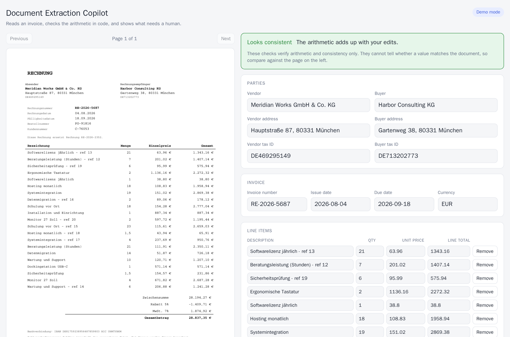
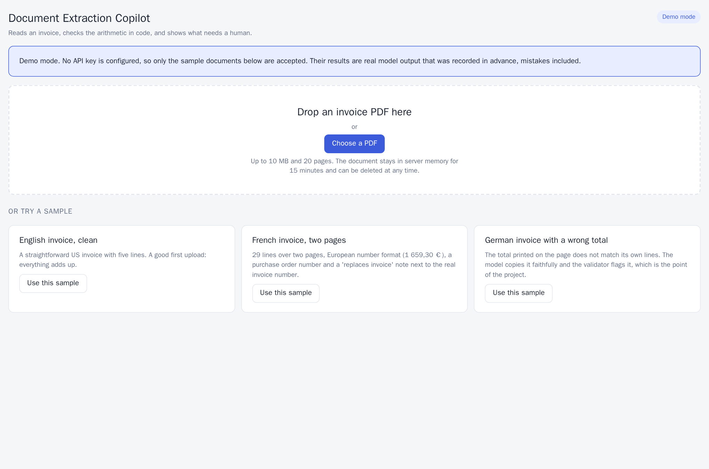
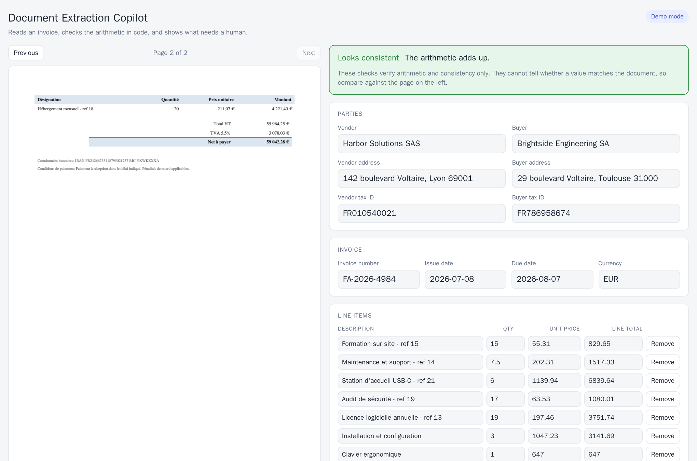
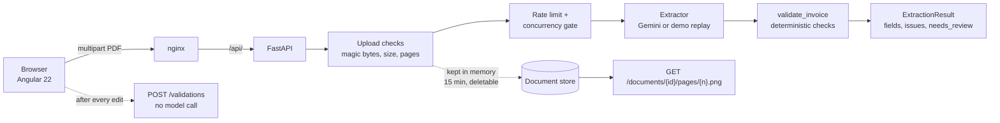

# Document Extraction Copilot

[](https://github.com/Volodymyr-Palchynskyi/doc-extractor/actions/workflows/ci.yml)

Extracts structured data from invoice PDFs, **checks the arithmetic in code instead of trusting the model**, and tells a human when a document needs review. The interesting part is not the model call but how it is measured: every number in this project can be checked against synthetic documents with exact ground truth.

**Stack:** Angular 22 (signals) · FastAPI · Gemini (native PDF input + structured output) · Pydantic · pypdfium2 · reportlab (test data) · Docker · GitHub Actions

> **Status: working end to end, with a review UI.** Backend, validation, eval harness, an Angular review screen and a first real-model run on the `dev` split are done; the sealed `test` split has not been run. The first run scored 100% exact on `dev`, and an ablation shows why that should not be read as "the extractor is 100% accurate": the synthetic documents turned out too easy to separate a good system from a mediocre one (see [First results](#first-results)). Not built: harder (scanned-looking) documents, see [Roadmap](#roadmap).

## Try it in two minutes (no API key)

```bash
git clone https://github.com/Volodymyr-Palchynskyi/doc-extractor.git && cd doc-extractor
docker compose up --build        # then open http://localhost:8082
```

Without a `GEMINI_API_KEY` the app starts in **demo mode**: it accepts the three bundled sample invoices and replays what the real model returned for them, recorded in advance with `python -m evals.record_demo`. The recordings are real model output, not hand-written answers, so the demo shows real behaviour, mistakes included. The UI says "Demo mode" on every screen. Put a key in `backend/.env` and the same app calls the model for any PDF.

## Screenshots

**A document that needs review.** The page is on the left, the extracted fields on the right. The total printed on this German invoice does not match its own lines: the model copied it faithfully, and the validator (plain `Decimal` arithmetic, no model) says exactly why and where.



**A human fixes it, and the check re-runs.** Editing a field marks it as edited and re-validates after a short pause, with no model call. The summary turns green; exporting JSON or CSV gives the corrected values.



<details>
<summary>More screens: start screen and a two-page document</summary>





</details>

## Example

`dev-hard-03.pdf` is a German invoice, 21 lines, with a total that is wrong **on the page itself** (a deliberately injected error). One call with the real model:

```bash
curl -F "file=@backend/evals/dataset/dev/dev-hard-03.pdf;type=application/pdf" http://localhost:8000/api/v1/extractions
```

```json
{
  "extraction": {
    "vendor": {
      "name": "Meridian Works GmbH & Co. KG"
    },
    "buyer": {
      "name": "Harbor Consulting KG"
    },
    "invoice_number": "RE-2026-5687",
    "issue_date": "2026-08-04",
    "due_date": "2026-09-18",
    "currency": "EUR",
    "line_items": "... 21 items ...",
    "subtotal": 28194.27,
    "discount_total": 1409.71,
    "tax_total": 1874.92,
    "total": 28837.35
  },
  "issues": [
    {
      "code": "total_mismatch",
      "severity": "error",
      "field": "total",
      "message": "Subtotal 28194.27 - discount 1409.71 + tax 1874.92 = 28659.48, but the total is 28837.35."
    }
  ],
  "needs_review": true,
  "usage": {
    "model": "gemini-3.7-flash",
    "total_tokens": 2959,
    "latency_s": 9.8
  }
}
```

The model copied the printed total faithfully (28,837.35) instead of correcting it, and the validator, not the model, found that subtotal minus discount plus tax is 28,659.48. `needs_review` tells a human to look, and the issue names the exact field.

## How it works



1. The upload is checked by **content**, not by the declared type: `%PDF-` header, size cap read incrementally, page limit, and a real parse (corrupt or password-protected files get a 422).
2. The PDF itself goes to a multimodal model with the `InvoiceExtraction` schema, temperature 0. The prompt tells the model to copy numbers **as printed, even when they look wrong**.
3. `validate_invoice` recomputes everything with `Decimal` at cent precision: quantity × unit price per line, sum of lines against the subtotal, subtotal − discount + tax against the total, due date not before issue date, currency code format. Each failure is an `Issue` with a stable code and the exact field path (`line_items[3].line_total`).
4. `needs_review` is true when any error-level issue exists. The model is never asked to do arithmetic or to judge its own confidence.
5. The PDF is kept **in memory only** under an unguessable id (15 minute TTL, caps on count and total size, explicit delete), so the UI can show page images next to the fields. Nothing is written to disk.
6. After a human edits a value, the UI calls `POST /validations`: the same checks, no model call, cheap enough to run after every pause in typing.

## Why the evals are built the way they are

**Synthetic invoices with exact ground truth.** [`evals/synth`](backend/evals/synth) generates documents from seeds, so labels are correct by construction, there is no personal data, and the whole dataset is reproducible and committed (`backend/evals/dataset`, about 400 KB). Difficulty comes from:

- three layouts with different fonts and structure, so position alone does not work;
- four locales with different **date and number conventions** (`1,234.56` / `1.234,56` / `1 234,56`; `03/04/2026` read month-first or day-first);
- up to 32 lines across two pages, with repeated table headers and "Page 1 of 2" footers;
- **distractor numbers** placed next to the real invoice number (PO number, customer ID, "this invoice replaces invoice X", IBAN, BIC);
- optional fields that are missing, discounts, and different tax rates;
- **printed arithmetic errors**: in some documents a total, subtotal or line total is wrong on the page itself, as in real life. The ground truth stores what is printed, so a good extractor copies the error and the validator catches it.

**Scoring is field level.** Per field (number, dates, currency, party names, tax IDs, four amounts) and per line item (matched by description similarity, then quantity, unit price and line total compared at cent tolerance). A document is "exact" only if everything is right. Two extra metrics matter for a review workflow:

- **false alarms**: the document is consistent but the extraction made the validator complain, which means an extraction error;
- **missed**: the document is inconsistent as printed but the extraction came out consistent, which means the model silently "fixed" it. This is the dangerous one.

**The harness is tested against itself.** An `oracle` extractor returns the ground truth and must score 100% on every run (CI fails otherwise), and the validator must agree with the generator's injected errors on all 56 documents.

**Two splits, one of them sealed.** `dev` is for building and debugging. `test` is for reporting a finished configuration, and the CLI refuses to run it without `--final`. This is the lesson from my previous project, [rfp-copilot](https://github.com/Volodymyr-Palchynskyi/rfp-copilot), where results on the set I tuned against were far better than on fresh data.

```bash
cd backend
uv run python -m evals --split dev --extractor oracle      # harness sanity check, no API needed
uv run python -m evals --split dev --extractor gemini      # real model run (needs GEMINI_API_KEY)
uv run python -m evals --split dev --extractor gemini --prompt minimal   # ablation: no extraction rules
uv run python -m evals --split test --extractor gemini --final   # once, when the configuration is frozen
uv run python -m evals.synth                               # regenerate the datasets (deterministic)
```

## First results

Model `gemini-3.7-flash`, native PDF input, temperature 0, `dev` split (28 documents: 8 easy, 10 medium, 10 hard, 5 with a printed arithmetic error). Single run each.

| prompt | exact documents | fields right | line items right | false alarms | missed printed errors |
|---|---|---|---|---|---|
| full extraction rules | **28 of 28** | 100% | 100% | 0 | 0 of 5 |
| minimal ("Extract the invoice data from the document.") | 24 of 28 (86%) | 98% | 100% | 0 | 0 of 5 |

Cost and speed: about 12 s and 2,500 tokens per document with the full prompt (2,030 tokens and 10 s with the minimal one). No price is configured, so no dollar figure is claimed.

**How to read this.**

- The model handled every hard feature the generator builds **without being told about it**: locale number formats, ambiguous dates, the distractor numbers (PO, customer ID, "replaces invoice X"), tables across two pages, and the five arithmetic errors printed on the page, which it copied faithfully instead of correcting. The validator flagged all five.
- The only thing the full prompt fixed was the **tax ID label**: with the minimal prompt the model drops "EIN" from US tax IDs (all four failing documents are that single field).
- So this dataset does not discriminate between a good extractor and a mediocre one on any axis except a labelling convention. A 100% on it says the model is strong on **clean, text-based synthetic PDFs**, and nothing about scans, photographs, handwriting or real-world mess.
- I have **not** run the sealed `test` split. It comes from the same generator, so it would very likely also score near 100% and would spend the seal without telling me anything. It is reserved for when there is harder data to put it next to.

**A mistake in my ground truth, found by the first run.** The first smoke test on three documents showed `tax_id` failing in two of them. Looking at the actual outputs, the model was right and my labels were wrong: for US documents the ground truth contained the label ("EIN 104890954") while the model returned the identifier ("104890954"), which is the better answer. I fixed the labels (the identifier without its label; the label is still printed on the page, so the PDFs are byte-identical) and added a sentence to the prompt, rather than loosening the metric. The `test` split had not been run at that point; the regeneration changed only its `truth.jsonl`. The hand-written prompt and the labels were both adjusted after seeing `dev` results, which is one more reason `dev` numbers are optimistic.

## Running it

```bash
docker compose up --build                 # UI http://localhost:8082 , API http://127.0.0.1:8000/docs
cp backend/.env.example backend/.env      # optional: set GEMINI_API_KEY to use the real model
```

Without Docker (Node 24 for the frontend, Python 3.12+ and [uv](https://docs.astral.sh/uv/) for the backend):

```bash
cd backend && uv sync && uv run uvicorn app.main:app --reload     # API on :8000, demo mode without a key
cd frontend && npm ci && npx ng serve                             # UI on :4200
```

```bash
cd backend && uv run pytest               # 80 tests, no API key needed
cd frontend && npx ng test --watch=false  # 74 tests
```

Modes are set with `EXTRACTOR`: `auto` (default: the model if `GEMINI_API_KEY` is set, otherwise demo), `gemini` or `demo`.

`dev-hard-03.pdf` (also the "German invoice with a wrong total" sample) has a deliberately wrong printed total: a correct run returns `needs_review: true` with a `total_mismatch` issue.

## Decisions and trade-offs

- **The model reads, the code checks.** Asking an LLM whether an invoice adds up is slower, costlier and less reliable than `Decimal` arithmetic. The prompt even forbids "correcting" numbers, because a corrected number hides a problem the reviewer needs to see.
- **Native PDF input instead of text extraction.** Tables and layout survive when the model sees the page. The cost is tokens per page and no control over how the PDF is read. A text-only baseline is on the roadmap so this choice can be measured rather than assumed.
- **Floats in the schema, `Decimal` in the checks.** Structured output works with plain numbers; money is converted through its shortest repr and rounded half-up to cents before any comparison, with a one-cent tolerance for rounding differences between invoicing systems.
- **Errors are specific.** Every issue has a stable `code` and a field path, so a UI can highlight exactly the cell that is wrong.
- **Form state is text, not numbers.** The review form keeps exactly what the user typed and converts to an invoice only when every field is readable. That is what lets the UI say *which* field is not a number, and tell "empty" from "12,". Control keys equal the backend's issue paths, so a validator issue finds its input with no mapping table.
- **Dates are ISO text, not a date picker.** A native picker shows the date in the browser's locale, which on invoices from several countries recreates the day-first / month-first confusion the data is full of. I noticed this on my own screenshot (08/04/2026 next to a page printing 04.08.2026) and replaced it.
- **Re-checks are debounced and cancellable.** One check follows a burst of edits, a newer check cancels the older request, and an answer that arrives late is dropped, so a slow response can never overwrite a fresher one. This is covered by tests that control the order of responses.
- **Privacy by construction.** Invoices are sensitive, so uploads live in memory only, expire, can be deleted from the UI, and have ids that cannot be guessed (the page endpoint has no other access control). The 404 for "never existed", "expired" and "no such page" is identical.
- **Abuse protection from day one.** Per-IP sliding-window rate limit (in memory, so single process), a non-blocking cap on concurrent model calls (503 instead of queueing), upload size and page limits, generic 500 messages that do not leak upstream errors, 503 with a clear message when the service is not configured.

## Known limitations

- **The datasets are too easy to measure quality.** A strong model scores 100% on `dev` and loses almost nothing without the extraction rules (see [First results](#first-results)). The prompt was written knowing the kinds of distractors in `dev`, so `dev` results are optimistic by design, and the sealed `test` split, from the same generator, would not be a hard test either.
- **Synthetic documents are cleaner than reality.** They are text PDFs from one generator. Scans, photographed pages, handwriting, stamps, skewed tables and unusual real-world layouts are not covered, and accuracy there will be lower.
- **Invoices only**, and only the fields listed in the schema (addresses are extracted but not scored).
- **The validator cannot catch errors that keep the arithmetic consistent**, for example a misread quantity with a matching misread line total. Field accuracy against ground truth is what measures that, and only on synthetic data.
- **No auth, no multi-tenancy, no database.** Rate limits and the document store are in memory, so they work for one process; several instances would each keep their own and need a shared store (Redis with a TTL).
- **The UI helps a human check values against the page, it does not prove they are right.** The validator only knows arithmetic. A misread digit that keeps the sums consistent passes silently, which is why the screen puts the original page next to the fields.
- **Demo mode replays three recordings.** It shows real behaviour on those documents only; it is not a measure of accuracy.
- **The dataset is small** (28 documents per split): one document moves a percentage by several points.

## Roadmap

1. The sealed `test` split is deliberately not run: it comes from the same generator as `dev`, so it would only repeat the near-100% result. Run it once, with `--final`, when there is harder data to put next to it (item 4) or when a concrete decision depends on it.
2. Baseline comparison: PDF text extraction + LLM versus native PDF input, on the same documents.
3. Model fallback on 429/5xx before output, as in rfp-copilot.
4. Harder data, only if the project grows beyond a demo: scanned-looking pages (rasterised, rotated, noisy, JPEG-compressed, image-only PDFs), stamps and handwriting-like annotations, then a new sealed split. Without it the harness cannot tell a good extractor from a mediocre one.
5. UI: highlight the field's position on the page image (needs word coordinates from the PDF), and keyboard shortcuts for working through many documents.

## Project layout

```
backend/
  app/
    api/            upload, documents (page images), validations, samples; rate limiting and wiring
    schemas/        InvoiceExtraction (model output), Issue, ExtractionResult, Usage
    services/       GeminiExtractor, DemoExtractor, validate_invoice, DocumentStore, page renderer
    demo/           recorded real model output and the sample PDFs for demo mode
    core/           settings, rate limiter and concurrency gate
  evals/
    synth/          invoice generator, renderer, dataset builder
    dataset/        committed dev and test splits (PDF + truth.jsonl)
    metrics.py      field, line item and validator-agreement scoring
    runner.py       runs an extractor over a split, writes reports to results/
    record_demo.py  re-records the demo samples with the real model
  tests/            80 tests, all offline
frontend/
  src/app/
    invoice-form.ts form state as text, conversion, edits, change tracking, CSV (pure, 37 tests)
    review-store.ts debounced, cancellable re-validation and the merged list of issues
    api-client.ts   typed fetch client and readable error messages
    *.ts            upload panel, page viewer, review panel, field
  nginx.conf        static hosting and the /api/ proxy
scripts/smoke.sh    API smoke test through the nginx proxy (runs in CI against the full stack)
e2e/                browser test (Playwright in Docker) that also produces docs/images/*.png
docs/images/        screenshots, produced by the browser test
```

## License

[MIT](LICENSE). The license covers this repository's own code and data. Dependencies keep their own licenses.
